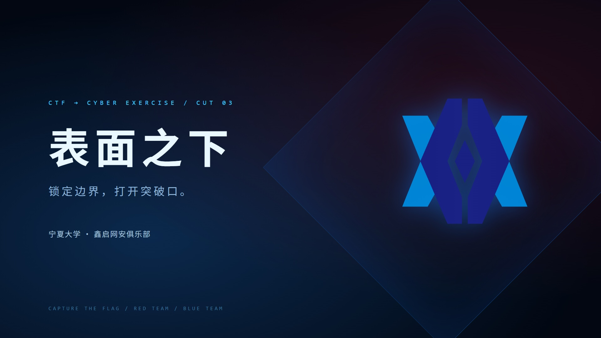

# 《表面之下》

**CTF 黑客主题程序动画宣传片 · 鑫启网安俱乐部 · 宁夏大学**

从CTF赛场的五条解题线，到护网邀请与红蓝攻防演练，本片展示发现问题、突破边界、监测响应和修复复测的过程。

影片规格为 **150 秒、1920 × 1080、30fps**，使用 React 与 Remotion 编写确定性的逐帧动画，第三版采用本机ACE-Step生成的电子配乐与独立程序音效。

源码与制作说明由本项目管理，MP4 和完整资产包通过 GitHub Releases 分发。

当前工作版本为 **第三版 v3.0.0**：CTF章末提交、一血与排名第一，经邀请邮件进入红方渗透与蓝方响应，以修复复测和红蓝汇聚收束。配乐方向为用户审听选定的C《红蓝交锋》。片尾保留已确认的SVG Logo、口号 **“见微知隙，破阵无声。”**及[俱乐部主页](https://ningxia-xinqicyberclub.github.io/)二维码。制作说明见 [docs/v3-direction.md](docs/v3-direction.md)，已审定脚本见 [docs/v3-storyboard.md](docs/v3-storyboard.md)。下方Release链接仍指实际已发布版本。



[下载 MP4](https://github.com/NingXia-XinQiCyberClub/ctf-beyond-the-interface/releases/latest/download/beyond-the-interface-1080p.mp4) · [查看 Releases](https://github.com/NingXia-XinQiCyberClub/ctf-beyond-the-interface/releases)

## 内容说明

影片包含 Web、Crypto、Reverse、Pwn、Misc 五个方向，以虚构 CTF 比赛串联。比赛名称、题目、对手、积分、排名变化与一血通知均为剧情演示，不代表俱乐部的实际参赛成绩或获奖记录。**片中 Flag 统一为演示值 `flag{test}`。**

CTF系统、密文和内存视图为剧情演示。护网界面根据本机临时HTTP靶场的真实请求和响应制作：跨身份读取、异常任务、阻断、授权修复、403/200复测；原始结果在`src/data/range-evidence.json`。这是确定性动画重现，不是实战录像或真实机构SOC记录。邮件发件人为虚构“演练协调组”，没有实际投递。全部正式署名和队伍标识统一使用完整名称 **“鑫启网安俱乐部”**。

项目由 Codex 辅助开发，包含人工确定的主题、品牌要求与制作脚本，以及 AI 辅助编写的动画、音频生成代码和发布文档。项目不宣称由 Claude Opus 生成。

## 本地运行

准备 Node.js **22 或以上版本**、npm、Git与Python 3.12。音频编排需要NumPy。首次安装依赖和准备资产需要联网；视频使用Chromium渲染，Windows优先使用已安装的Chrome，也可通过`REMOTION_BROWSER_EXECUTABLE`指定路径。

```sh
git clone https://github.com/NingXia-XinQiCyberClub/ctf-beyond-the-interface.git
cd ctf-beyond-the-interface
npm ci
python -m pip install -r requirements-audio.txt
npm run assets
npm run range
npm run audio
npm run dev
```

`npm run assets`准备中文字体与二维码；`npm run range`运行回环HTTP验证；`npm run audio`根据已包含的ACE-Step音乐素材重建150秒配乐和独立音效，无需下载音乐模型。音频素材、生成任务与提示词记录在`public/music/`。浏览器打开Remotion Studio，选择`BeyondTheInterface`预览。

## 检查与导出

```sh
npm run typecheck
npm run render
```

完整视频输出到：

```text
dist/beyond-the-interface-v3-1080p.mp4
```

渲染使用 H.264、AAC 音频与 `yuv420p` 像素格式。耗时取决于处理器、内存、并发设置和 Chromium 性能。

另有低分辨率预览与封面命令：

```sh
npm run preview
npm run cover
```

`npm run preview`输出`dist/preview-v3-720p.mp4`。依赖、缓存和构建输出不进入源码历史，MP4通过Releases分发。

## 影片结构

| 时间        | 章节     | 内容                                            |
| ----------- | -------- | ----------------------------------------------- |
| 00:00–00:10 | 入口     | 侦察、目标锁定、五方向                          |
| 00:10–00:22 | Web      | 对象访问与授权边界                              |
| 00:22–00:32 | Crypto   | 模数、密钥与明文                                |
| 00:32–00:42 | Reverse  | 控制流与校验                                    |
| 00:42–00:54 | Pwn      | 崩溃、偏移与受控执行                            |
| 00:54–01:04 | Misc     | 隐藏通道与位流                                  |
| 01:04–01:30 | CTF终局  | 87.3秒提交、88.3秒CORRECT、88.8秒一血、排名第一 |
| 01:30–01:38 | 护网邀请 | 片内邮件、进入联合演练                          |
| 01:38–02:20 | 红蓝攻防 | 同一请求链、异常任务、阻断隔离、修复复测、归档  |
| 02:20–02:30 | 落版     | SVG Logo、完整名称、口号与二维码                |

## 目录

```text
.
├── src/                      # Remotion composition 与动画场景
│   └── scenes/               # 技术章节、开场、终局与片尾
├── public/                   # 本地使用的品牌、字体、二维码与合成音轨
├── scripts/                  # 资产准备与原创音轨生成脚本
├── docs/                     # 制作脚本、音频说明与发行说明
├── prompts/                  # 创作方向与制作提示记录
├── .github/workflows/        # 安装、资产准备与类型检查
├── ASSETS.md                 # 素材来源与各自授权
├── CHANGELOG.md
└── LICENSE                   # 项目自有代码的 MIT 许可证
```

## 素材与许可证

- 项目自有动画代码、生成脚本与程序图形按 [MIT License](LICENSE) 发布。
- Logo 与“鑫启网安俱乐部”名称属于俱乐部品牌素材，**不随代码以 MIT 许可授权**。
- Noto Sans SC 字体遵循其 SIL Open Font License，保留相应许可证与版权声明。
- 第三版配乐由本机ACE-Step 1.5生成，参考用户选定的C小样继续发展；独立音效由仓库脚本合成。生成记录与模型来源在`public/music/`，没有使用参考视频的音轨。
- Remotion 及其他依赖保留自身许可证。**本项目的 MIT 许可证不改变 Remotion 的许可条件**；安装和使用以 [Remotion 官方现行条款](https://www.remotion.dev/docs/terms) 为准。

各项来源及适用范围见 [ASSETS.md](ASSETS.md)。如复用源工程，请替换品牌素材并保留第三方授权文件。

## 俱乐部

- [GitHub 组织](https://github.com/NingXia-XinQiCyberClub)
- [公开主页与加入方式](https://ningxia-xinqicyberclub.github.io/)
- [CTF 入门资料](https://github.com/NingXia-XinQiCyberClub/guide)

项目中的教学和挑战演示面向 CTF 与授权实验环境。对内容或实现的改进可通过 Issue 或 Pull Request 提出。
